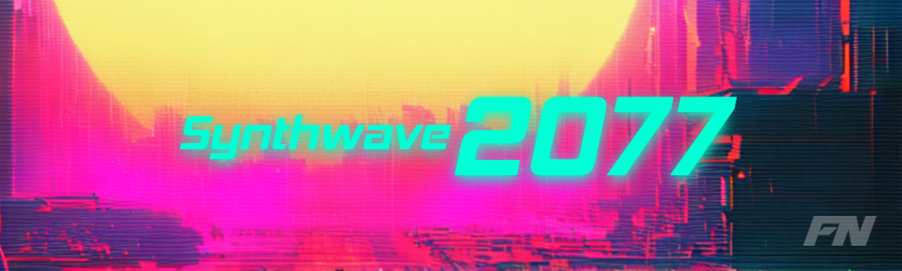
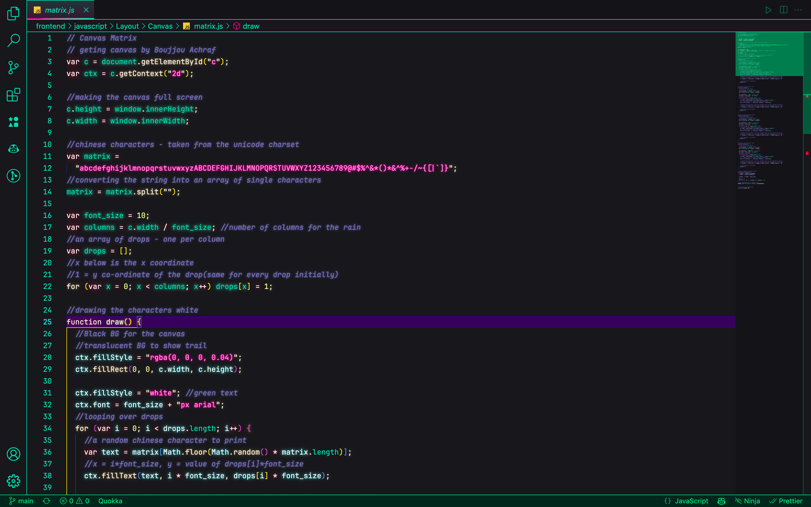
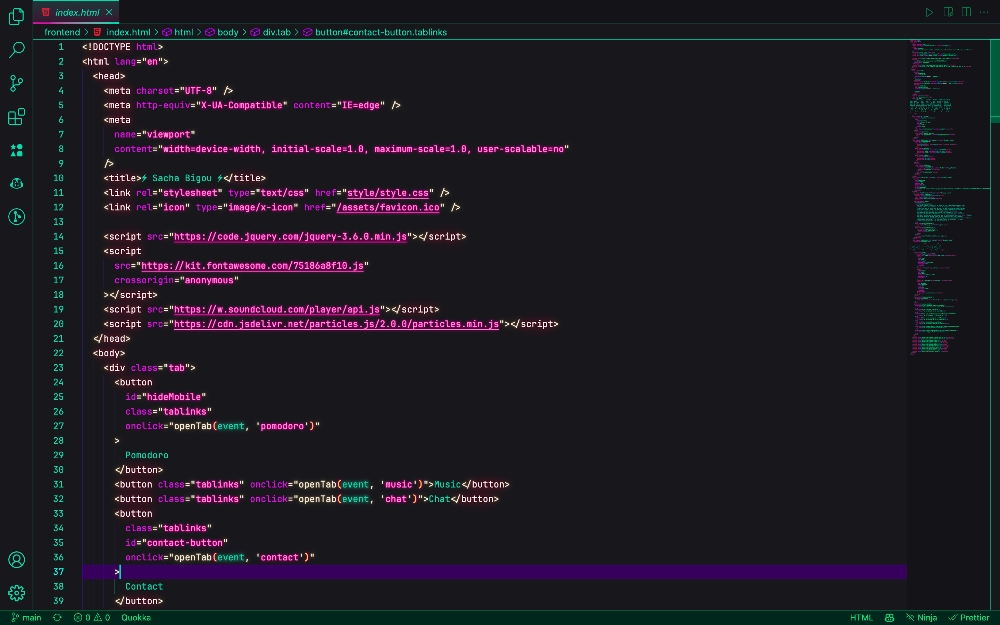
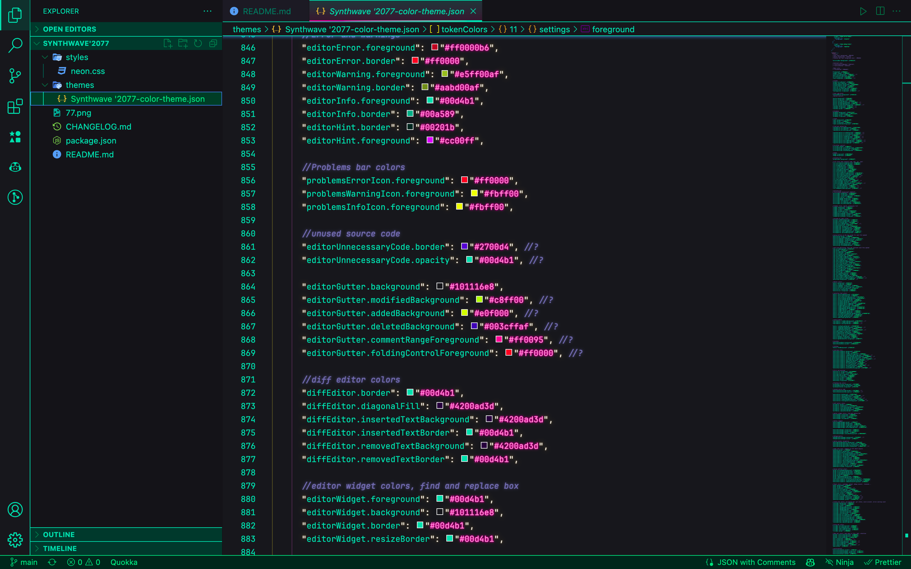
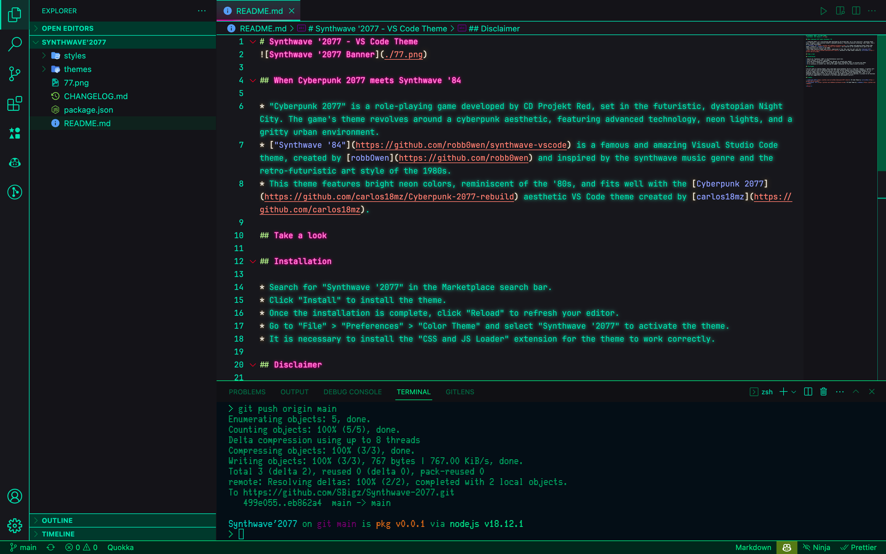

# Synthwave 2077 - VSCode Theme



## When Cyberpunk 2077 meets Synthwave '84 🌇

Get ready to dive into a futuristic, dystopian world with the "Synthwave 2077" VSCode theme, where Cyberpunk 2077 meets [Synthwave '84](https://github.com/robb0wen/synthwave-vscode). Cyberpunk 2077, a popular role-playing game developed by CD Projekt Red, inspires the theme's design with its advanced technology, neon lights, and gritty urban environment. Synthwave '84, a fantastic VSCode theme created by [robb0wen](https://github.com/robb0wen) sets the theme's mood with its retro-futuristic art style and synthwave music genre inspiration. The result is a unique, eye-catching theme created by [SBigz](https://github.com/SBigz) that will transport you to a world of neon lights, cybernetic enhancements, and advanced technology. Some adjustments and fixes were made by [Faisal N](https://faisaln.com).

## Key Features 🚀

- Bright neon colors reminiscent of the '80s, fitting for the [Cyberpunk 2077](https://github.com/carlos18mz/Cyberpunk-2077-rebuild) aesthetic VSCode theme created by [carlos18mz](https://github.com/carlos18mz).
- Sleek design and easy on the eyes, improving your coding experience
- Compatible with most programming languages
- Available for Windows, macOS, and Linux

## Take a look 🤩

These screenshots are from a previous version of the theme, modifications were made that may not be reflected in the images below.









## Installation 🔌

1. Open the **Marketplace** in Visual Studio Code and search for **"Synthwave 2077."**
2. Click the **"Install"** button to add the theme to your VSCode.
3. To activate the theme, go to **"File" > "Preferences" > "Color Theme,"** and select **"Synthwave 2077."**
4. To enable the Neon of **"Synthwave 2077,"** check the instructions below.

### Neon Glow Effect 🌟

Install the [Synthwave 2077 Neon Glow companion extension](https://marketplace.visualstudio.com/items?itemName=DangoWeb.synthwave-2077-neon-glow), then activate the neon glow by going to **"Help" > "Show All Commands"** and searching for **"Toggle Neon Glow."** You can also use the keyboard shortcut **Ctrl+Shift+P** (Windows/Linux) or **Cmd+Shift+P** (macOS) to open the command palette and search for **"Toggle Neon Glow."** Requires VS Code 1.100 or later.

## Disclaimer 👀

This theme, Synthwave 2077, was created by SBigz (CodeSasha) and this is just a fork of his repo [SBigz/Synthwave-2077](https://github.com/SBigz/Synthwave-2077) made due to it being incompatible with my VSCode version. I loved how it looked at first sight, and was heartbroken when I saw that I couldn't use it. It also left out the neon glow effect, which I thought was a cool feature. So I decided to fix it and make it compatible with my VSCode version. I'm not the original creator of this theme, I just made it work for me and decided to share it with the world. All credits go to SBigz, robb0wen, and carlos18mz for creating this awesome theme.

## Credits ✨

- [Cyberpunk 2077](https://github.com/carlos18mz/Cyberpunk-2077-rebuild) VSCode Theme by [carlos18mz](https://github.com/carlos18mz)
- [Synthwave '84](https://github.com/robb0wen/synthwave-vscode) VSCode Theme by [robb0wen](https://github.com/robb0wen)
- [Synthwave '2077](https://github.com/SBigz/Synthwave-2077) VSCode Theme by [SBigz](https://github.com/SBigz)

## Build the VSIX

To build and install from source, clone this repository and navigate to the `theme` directory. From this directory, run:

```sh
npx --yes @vscode/vsce package
```
